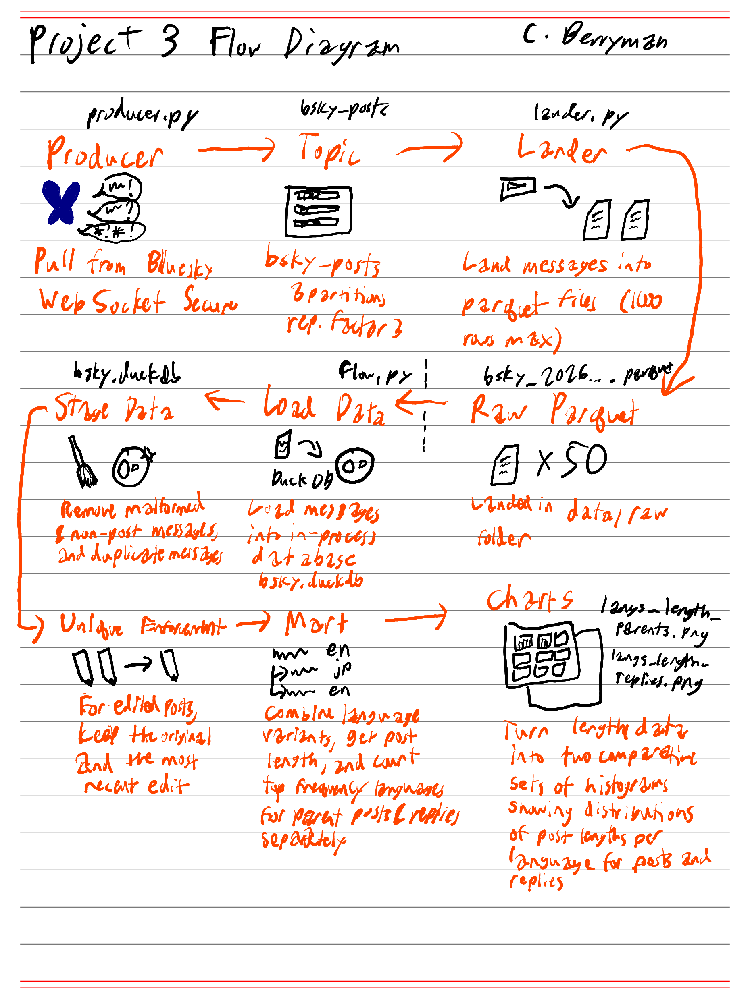
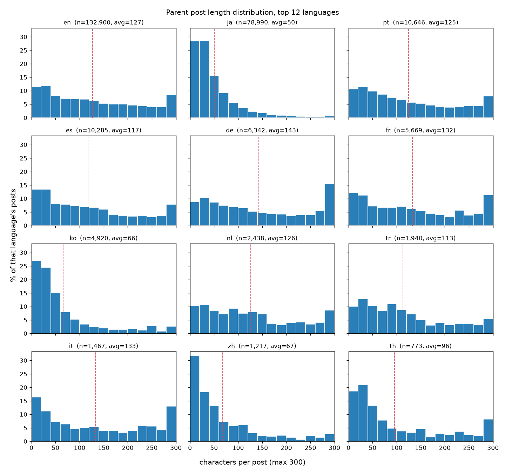
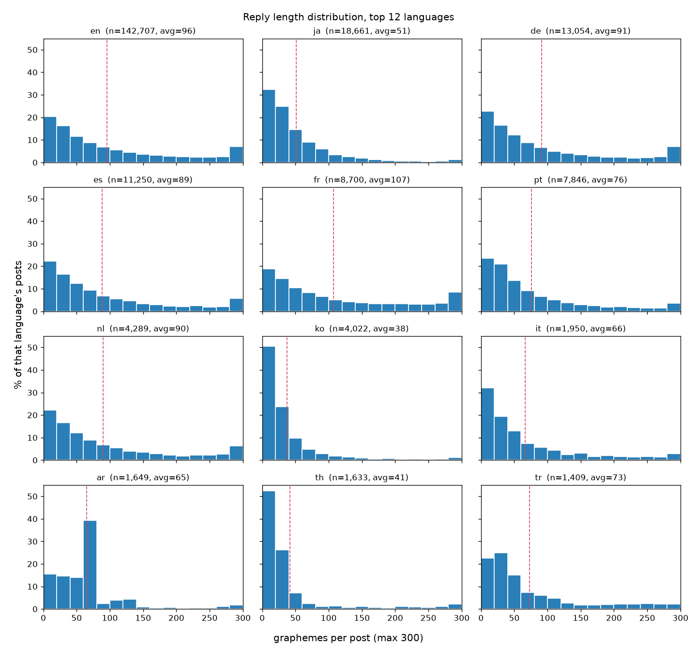

# Less is More: How Long are Bluesky Posts Across the World?

**Author:** Cameron Berryman
**DS 3022 Data Project 3, Fall 2026**

## Data source

Push: Bluesky. Pulls activity from Bluesky, a social networking service. No account, key, or user-agent are needed. A single message contains details about the user, action type, and data about the action, usually text if it was a post. Data comes out of a stream, not an archive.

## How to run

Without any running Docker containers, from the main folder ds3022-streaming:
```bash
# Virtual Environment
python -m venv .venv # try python3 if python by itself fails
source .venv/bin/activate
pip install -r requirements.txt

# Make sure Docker is installed and the daemon is running.
docker compose up -d    # compose the Redpanda (Kafka) cluster. Certain ports need to be free to run this command. If you run into conflicts, use "docker compose down" and then try it again.

docker exec -it redpanda-0 rpk topic create bsky_posts -p 3 -r 3
docker exec -it redpanda-0 rpk cluster info
```

```bash
# Collect data - skip if using existing data
cd project3
python producer.py              # connects to the Bluesky websocket and collects messages from it to place into the topic. Keyboard interrupt after ~17 minutes for 50k messages
```
Open a new terminal window, keep the old one
```bash
python lander.py                # lands the messages as parquet files in project3/data/raw. Stop after the lander is no longer landing messages (60 second timeout on last set of messages, will likely end on a collection that is less than 1000 and that is when it is safe to keyboard interrupt it)
python kit/make_sample.py       # SKIP THIS STEP IF THERE ARE ALREADY SAMPLE FILES PRESENT FOR COMPARISON IN GRADING. Collects a sample of the data and puts it in project3/data/sample. Replaces sample data if it already exists, so skip if the sample data numbers should exactly match what I have in the tables
```
Open a new terminal window, keep the old two
```bash
prefect config set PREFECT_API_URL=http://127.0.0.1:4200/api            #makes sure the prefect server persists and is non-temporary
prefect server start            # starts the Prefect server
```
Open a new terminal window, keep the old three
```bash
python flow.py data/sample      # runs the flow on the committed sample. Check the results in project3/charts
python flow.py                  # runs the flow on the entire dataset.  
```

## Architecture


## Design decisions

Answer each in 2-4 sentences, in your own words, with your own numbers.

1. **Key and partitions.** My key is a combination of 2 items in the message: did and rkey. The two of them ensure that operations linked to the same post (create, edit, delete) all land in the same partition and are read in the correct chronological order. If information about the same post was landed in different partitions (ex. including operation in the key), an edit could be read before the original post on accident. Events with no rkey (account changes) are just did as their key, so those also stay in order for individual accounts. Using did alone would make splits by account instead of by post, which would make bot accounts with high traffic potentially overload a partition. Many other keys would go wrong since they don't appear in every post action, but these two appear guaranteed in any commit involving a parent or reply post, which is the target of the research question.
2. **Batch size and time.** Batch size is 1000, with a 1-minute time limit. The post volume makes the 1000 mark be hit at almost every opportunity. 64.64 messages per second -> 232704 per hour, which is 233 files. That's a lot. I probably should have set the limit higher.
3. **Offsets after the file.** A crash sets the offset back to the point where it started reading that file. This is okay, since SQL selection in the flow eliminates duplicates with SELECT DISTINCT.
4. **Duplicates.** Same partition and offset are the same Kafka record. These are removed in the flow by the staging step, which runs SELECT DISTINCT on the data without the landing time, which is the only difference between the same Kafka record in two places. A post with the same did, rkey, operation, and time_us is the same action. These are cleared out in the entities step of the flow, as only one value with the same did, rkey, and operation is kept: the latest one. The SQL is a bit more complicated for this one: 
```sql 
QUALIFY row_number() OVER (PARTITION BY did, rkey, operation ORDER BY time_us DESC, kafka_offset DESC) = 1 
``` 

5. **Windows and time.** The time column is the event time. However, the division of data for my research question is based on a comparison between languages of messages, not changes between a time frame. The time window for this problem is just one window, being the entire time I was collecting messages. Time still needs to be tracked, as filtering is done in the unique entities part of the flow based on time to only keep the most recent copy of an event, removing duplicates and only keeping the most recent edit of a post.
6. **Ten times the volume.** I experienced this firsthand, the lander runs quite slowly with a lot of records backlogged. It likely wouldn't be able to keep up with 10x message volume. My first plan with higher message volume would be to read more messages at maximum so that fewer files need to be written. Since the producer doesn't print every message, it could likely still keep up. The flow isn't tethered to production, as it only reads already fully filled files once, so it would not break with higher message volume.


## Chaos round

**NOTE**  
I didn't understand that these were supposed to be run with messages already in the files. I cleared the landed files each time I ran one of these chaos cards. The numbers below are from a "normal" run of my producer for 15 seconds, with no chaos card active, for comparison:

**NORMAL RUN RESULTS (15 seconds)**

| raw |malformed | unique Kafka records | unique did+rkey+operation|
|-|-|-|-|
| 844 |  0 |  844 | 820 |

**CHAOS CARD RESULTS**

| Card | Prediction | What I did | Numbers before → after | Explanation |
|---|---|---|---|---|
| D1 Crash between file and offsets | (MY PREDICTION) Raw number and unique records increases but unique keys and malformed should be unchanged (CHAOS CARD PREDICTION) Raw +2x crashed batch size, unique records up 1x, unique entities up by amount dependent on what counts as unique per project | Ran lander with crash instead, then ran lander without crash | 0-0-0-0 -> 1190-0-595-586 | My prediction was off. The offset to read from isn't stored until the store offsets function is actually finished which comes after the file is finished, so the lander reads from the previous messages and then closes the offset. Delivery is at least once, so the re-landed records still exist. The flow, however, is idempotent, where data is cleaned with SELECT DISTINCT without landing time, removing those copies and their problems to the flow. |
| D2 Poison message | The individual message should land, but would be malformed | Manually produced a message with the CLI then landed it | 0-0-0-0 -> 1-1-0-0 | The poison message is logged as malformed, but still landed. All input is landed but culling through the data lets you decide what to keep later. Consumers should never crash when their input is poisoned because it would re-read the bad input every time it started over and get stuck, blocking its partition that it reads from. |
| D3 Broker stops | Results should be at scale of normal/standard run, replication factor covers every broker so one going down shouldn't lose any results | Manually disabled broker, waited, then booted it back up again while producer was running | 0-0-0-0 -> 4950-0-4950-4868 | No losses since replication factor is 3 (every broker). The majority (2 of the 3) of the brokers are still active, so writing can continue. The leader partition(s) from the downed broker move to one of the others that is still up. Some warning messages showed in the producer but production continued with replication in the remaining brokers. Dashboard showed as degraded and under-replicated until I manually restarted the broker. |

## The four numbers

From the flow log on the full data (screenshot in `docs/`):

| Number | Full data | Sample (`data/sample`) |
|---|---:|---:|
| Raw records landed | 606606 | 5000 |
| Malformed (kept in raw) | 0 | 0 |
| Unique Kafka records | 598357 | 4926 |
| Unique did+rkey+operation | 598187 | 4926 |

## Challenges / Obstacles

The sheer volume of messages was a little tough to manage at one point in the project. As you can probably tell from the number of parquet files and the number of records I have, I accidentally left the producer on while I was doing other things and pulled 600000 messages that all needed to be landed. While that only took a few minutes to land and clear the backlog, I needed to turn the producer off to catch up. If this was a real flow that needed continuous production, the clog of messages could have been disastrous for the lander and for file clutter. If I were to do it again, I would try to parse more messages at once so that there would be less writing overhead and fewer files. The messages also had a bit of a confusing ID layout that made selecting a key somewhat difficult, since there are some ID columns that are only present on certain types of messages. I made a copy of the probing script with edits to get statistics about what commit types (create, edit, delete) were missing certain keys. This let me select columns for keys that were present in all messages relevant to my question.

## Analysis

My research question was: how do post and reply lengths vary between languages on Bluesky? I ended up finding that different languages follow nearly the same pattern: short-dominated, tapering off as it gets longer, with a spike at max-length posts. Replies trend even shorter than posts. However, what surprised me the most is that there is a notable separation between East Asian languages (Japanese, Korean, Thai, Chinese) and the others, where East Asian languages tend to have disproportionately higher percentages of posts within 40 graphemes. For example, over 50% parent posts in Japanese are within 1-40 graphemes and over 30% of parent posts in variants of Chinese are within just 1-20. This is likely because individual graphemes can communicate more, either by sounds or by full words, in those languages. There is a major limitation in sample size, though, as English and Japanese posts alone take up a supermajority of the dataset (76% of analyzed rows), with the rest of the distribution spread unevenly across every other language. The flow would need to be run for much longer to get comparably sized datasets for the other languages.

## Plot / Visualization




## Reflection

The most important thing I learned about streaming systems is that you need to plan for failure. Getting live data is fantastic for immediate results, but at any moment, a connection could drop or a message could be malformed, and you need to be able to cover for that. Outages leave gaps in your dataset that invalidate time window-based analysis if you don't recover them. Power cuts will make duplicate data that skews your analytics if you don't make idempotent flows. You need to assume that everything bad will occur and plan accordingly. If I started this project over, I'd do some more analytics on the source itself and plan my flow around message volume. I left my source on for too long and have too many data files to show for it. I'll do some more work on the probing step and make sure that the ingestion volume is appropriately converted to number of files next time.

## Acknowledgements

Instructor: Alfonso Pons  
Generative AI: Claude Code, Opus 5.5
- I had a mishap in the last stages of my project where my lander file got deleted due to a renaming issue in git (originally called bsky_lander.py, got removed when renaming it to lander.py) and committing over it. The current lander.py is a copy identical to the version I had when it was deleted. If the lander shows as entirely AI-generated, it's because it is recovered from a clone of my repo that Claude made to test my reproduction instructions worked. It's not actually AI generated. I tested the recovered lander and it works as intended.
- Created a modified version of the probing script that tracks instances of duplicate did and rkey combinations (updates or deletions to the same post), as well as percentage prevalence of other JSON keys in messages that have both did and rkey in them and what message types (create, update, delete) were missing those keys. Helped me understand what keys were useful for making a Kafka key, such as what keys were missing from only deletions. I sampled some of the messages and read through them to check if the results seemed appropriate.
- Originally, I didn't have an envelope around the data, as I thought that was a convention of the earthquakes data set specifically rather than a convention to wrap all data sets. Claude helped me understand why enveloping mattered for message production (action field and data field) and refactored my existing code in the producer and lander to compensate for adding the envelope. 
- Helped implement logging and recovering data when the producer disconnected from Jetstream by saving the cursor at a timestamp. I tested this one manually by cutting my WiFi connection.
- I noticed the percentages had a very high number of posts at or above the character limit, which tipped me off that something might be wrong. Claude helped me understand the difference between querying for grapheme count vs. character count in SQL, which was important as Bluesky counts graphemes and I had character counts instead, which would skew my results towards being larger than they actually are. I tested this by seeing how the visualization changed after graphing them, and it revealed that there actually were a lot of posts at that length, but fewer than what it originally showed.
- Helped me write and format the SQL queries for pulling unique entities and organizing the mart of post length and subsetting by the most frequent languages, divided by parent posts and replies. There were a lot of different parameters that made complex nested queries necessary, and I likely would have taken hours to try and come up with the query myself. I ran these on sample data to make sure they worked. 
- I came up with the organization of the final charts (grid of histograms, one for each language, of post length with occurrence percentages as the y axis so they are comparable between different sample sizes), but Claude wrote the code to actually put the subplots together. I tested this one by making sure the chart aligned with my vision for it, and it worked great.